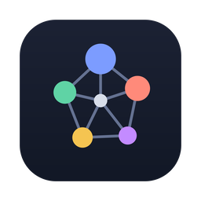
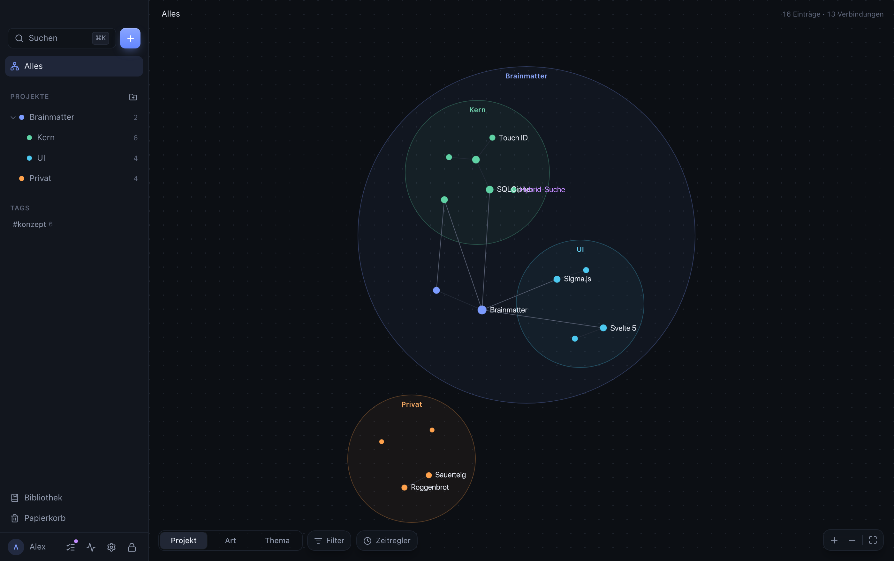
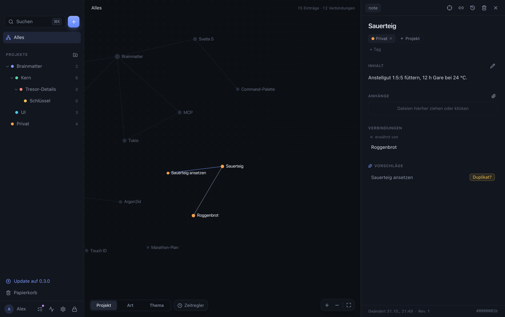
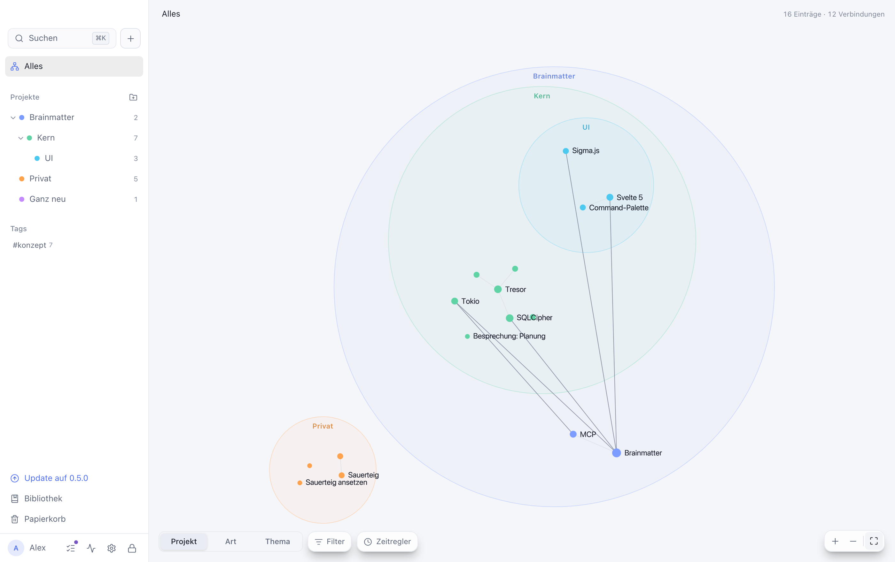
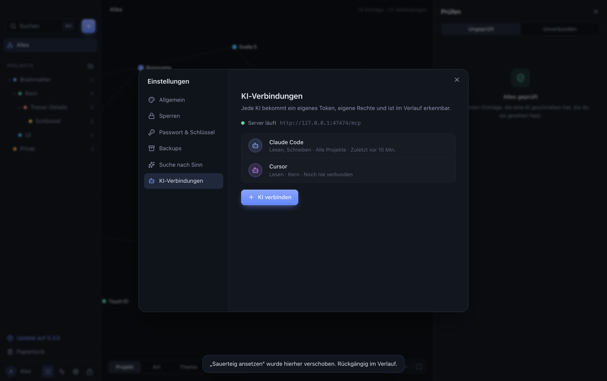
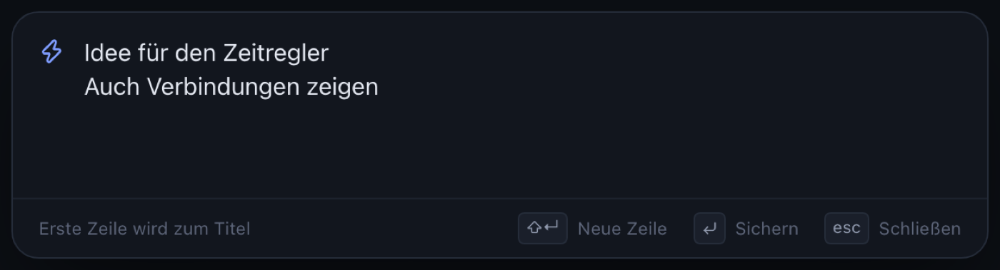

<p align="center">
  
</p>

<h1 align="center">Brainmatter</h1>

<p align="center">
  A local, encrypted knowledge graph for your Mac, and a shared memory for your AI tools.
</p>

<p align="center">
  <a href="https://github.com/Kiritosky/brainmatter/actions/workflows/ci.yml"></a>
  <a href="https://github.com/Kiritosky/brainmatter/releases/latest"></a>
  
</p>



Brainmatter keeps simple entries, connects them by topic, and groups them into nested projects. Everything is stored on your Mac in an encrypted vault. Claude, Cursor, Codex and other tools connect through [MCP](https://modelcontextprotocol.io), so they can read and extend the same knowledge across sessions, and you can see and undo everything they do.

> **Status:** early. Brainmatter is usable, but young: back up what you cannot lose. The user interface is in German for now.

## Features

**Knowledge graph**
- Markdown entries linked with `[[wikilinks]]` or typed relations such as `depends_on` and `contradicts`
- Projects nested to any depth, and an entry can be in several of them
- A graph that stays smooth with 50,000 entries, coloured by project, kind or automatically detected theme
- A time slider that replays how your graph grew
- Quick capture from anywhere with <kbd>⌥</kbd><kbd>⇧</kbd><kbd>Space</kbd>

**Search by words and by meaning**
- Full-text search in German and English, usually in about 12 ms on 50,000 entries
- An optional local model (about 490 MB, downloaded only if you ask) finds entries that share no word with your query, flags likely duplicates and suggests links

**AI access you stay in control of**
- Set up Claude Code, Claude Desktop, Cursor and Codex in one click
- Each client gets its own token, limited to read, write or delete, and optionally to certain projects
- Whatever an AI writes is attributed to it and marked as unreviewed until you have seen it
- Every change can be undone, one step at a time

**Encryption**
- The database, search index, embeddings, attachments and backups are all encrypted at rest
- Unlock with your password or Touch ID. While locked, an AI's request can ask you for Touch ID
- Locks automatically after a set time, on sleep, or with the screen

**Also included:** a library of templates and prompts with `{{placeholders}}`, encrypted attachments with previews, verified daily backups with restore, a trash, light and dark themes, signed automatic updates.

<table>
  <tr>
    <td></td>
    <td></td>
  </tr>
  <tr>
    <td></td>
    <td></td>
  </tr>
</table>

## Install

Requires macOS 13 or newer on Apple Silicon.

1. Download the DMG from the [latest release](https://github.com/Kiritosky/brainmatter/releases/latest) and drag Brainmatter to Applications.
2. Open it. macOS will refuse the first time, because the app is not notarized. Go to **System Settings → Privacy & Security** and choose **Open Anyway**.

Later versions install themselves from inside the app. After each update it asks for your password once, then Touch ID works again.

Write down the recovery key the app shows you when you create your vault. **Without your password or that key, your data cannot be recovered**, by anyone.

## Connect your AI tools

Open **Settings → KI-Verbindungen**, choose a tool and confirm. Brainmatter writes the configuration for you and never shows the token.

For anything else, create a token there and point the client at the local server:

```
http://127.0.0.1:47474/mcp
Authorization: Bearer <token>
```

Clients that only speak stdio can use the bridge inside the app bundle, `Brainmatter.app/Contents/MacOS/brainmatter-mcp`, with the token in `BRAINMATTER_TOKEN`.

| Tools | For |
|---|---|
| `search`, `get`, `explore`, `find_path`, `similar` | Finding and reading |
| `capture`, `update`, `link`, `unlink`, `merge`, `attach` | Writing |
| `list_projects`, `project_overview`, `create_project`, `add_to_project`, `remove_from_project` | Projects |
| `read_attachment`, `unreviewed`, `unlinked`, `recent_changes` | Reviewing |
| `delete`, `trash`, `restore`, `revert` | Removing and undoing |
| `list_templates`, `get_template`, `save_template` | Reusable templates and prompts |

Templates you have reviewed also appear as MCP prompts, so in Claude Code a template called "Code Review" becomes `/mcp__brainmatter__code-review`. Whatever an AI writes or changes in a template stays out of that list until you have looked at it.

Only you can mark entries as reviewed, erase them for good, manage backups or change settings.

## Security

| | |
|---|---|
| Database | SQLCipher (AES-256), including the search index and embeddings |
| Attachments | XChaCha20-Poly1305 with a key of their own; file names are keyed hashes |
| Key derivation | Argon2id (128 MiB, 3 passes) |
| Key hierarchy | A random data key, wrapped separately for password, recovery key and Touch ID |
| AI access | Local only (`127.0.0.1`), hashed bearer tokens, browser origins rejected |
| Network | Only update checks, which you can turn off, and the optional model download. Your entries never leave the Mac |

What this does not protect against: malware running as your user while the vault is unlocked, and a forgotten password together with a lost recovery key. Backups sit next to the vault, so they protect against mistakes and damaged data, not against losing the Mac.

Entries are treated as untrusted when shown: Markdown is sanitized, and AI clients are told that content is data, not instructions. To report a vulnerability, please use [GitHub's private reporting](https://github.com/Kiritosky/brainmatter/security/advisories/new).

## Build from source

You need [Rust](https://rustup.rs) (the version in `rust-toolchain.toml` installs itself) and [Bun](https://bun.sh).

```sh
git clone https://github.com/Kiritosky/brainmatter
cd brainmatter/app
bun install
bun run tauri dev
```

Development builds use a separate vault and port, so they never touch your real data.

To try the interface without the native app, `bun run dev` runs it in a browser against an in-memory mock (password `demo1234`).

| | |
|---|---|
| `cargo test --workspace` | All tests |
| `bun run check` (in `app/`) | Typecheck the frontend |
| `bun scripts/screens.ts` (in `app/`) | Click through the interface against the mock and save screenshots |
| `scripts/build-release.sh` | A signed `.app` and DMG, using an identity from `scripts/create-signing-cert.sh` |

Pushing a tag such as `v0.2.0` runs the [release workflow](.github/workflows/release.yml).

## Architecture

```
crates/bm-core    Encrypted storage, graph, search, history, attachments, backups
crates/bm-embed   The local embedding model (candle on Metal)
crates/bm-mcp     The MCP server: tools, tokens, scopes
crates/bm-cli     brainmatter-mcp, a stdio bridge to that server
crates/bm-macos   Touch ID, Keychain, sleep and screen-lock events
app/src-tauri     The desktop app (Tauri 2): lock session, setup of AI tools, updates
app/src           The interface (Svelte 5, Sigma.js, CodeMirror)
```

The core has no UI or network dependencies. [PLAN.md](PLAN.md) (in German) has the design decisions, measurements and known gaps.

## License

[MIT](LICENSE)
