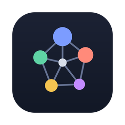
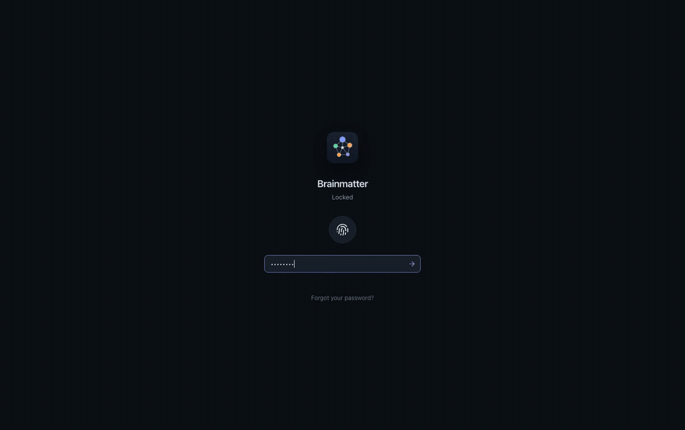
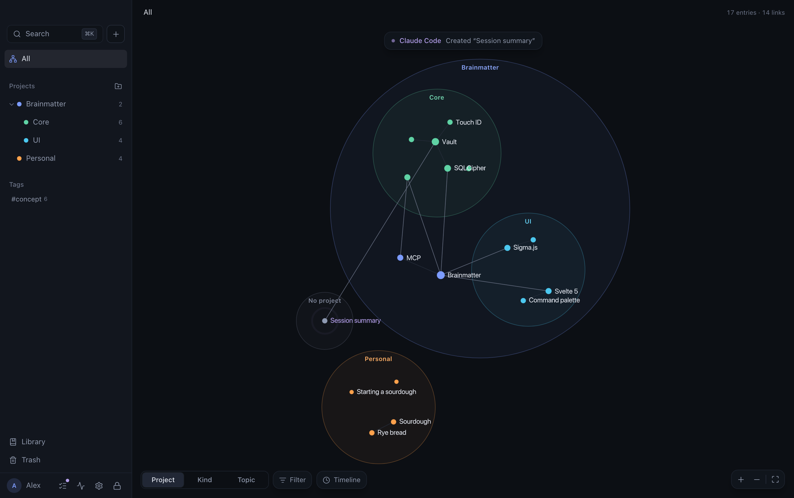
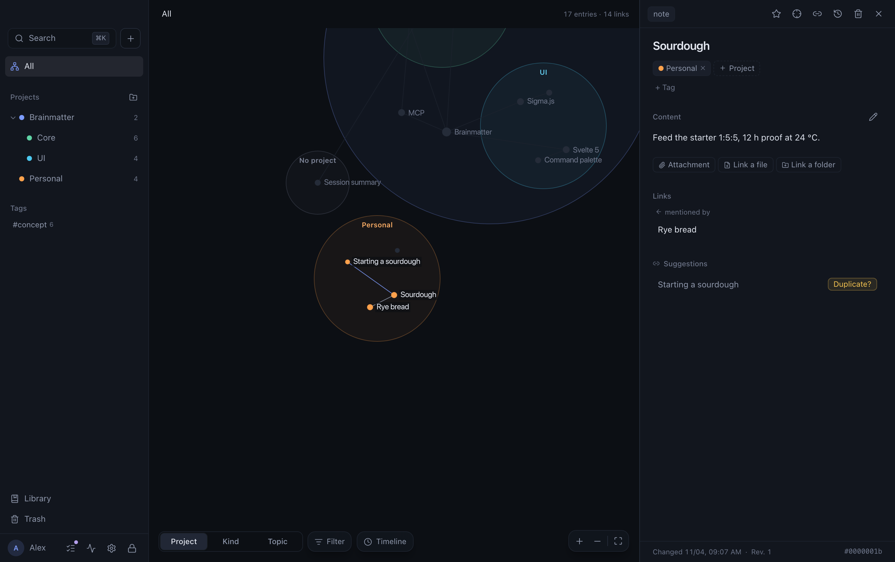
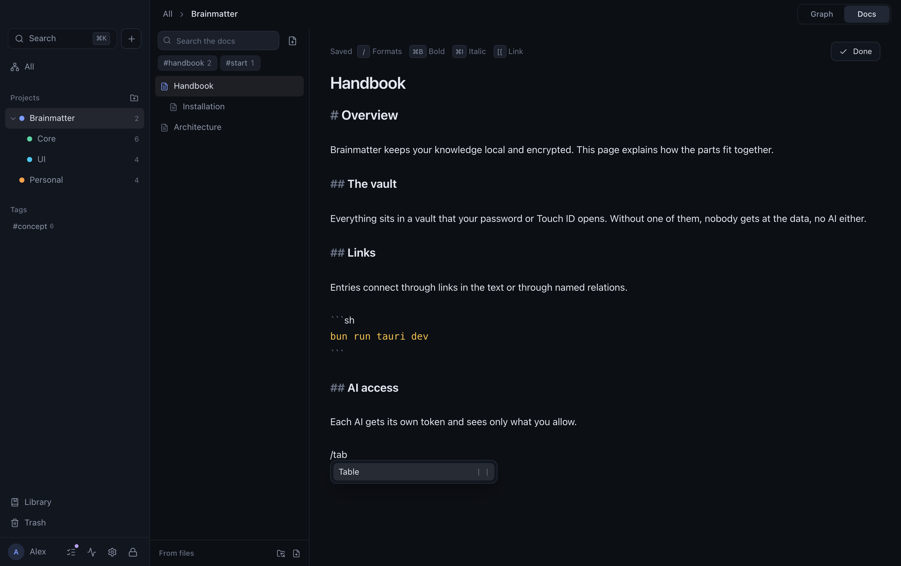
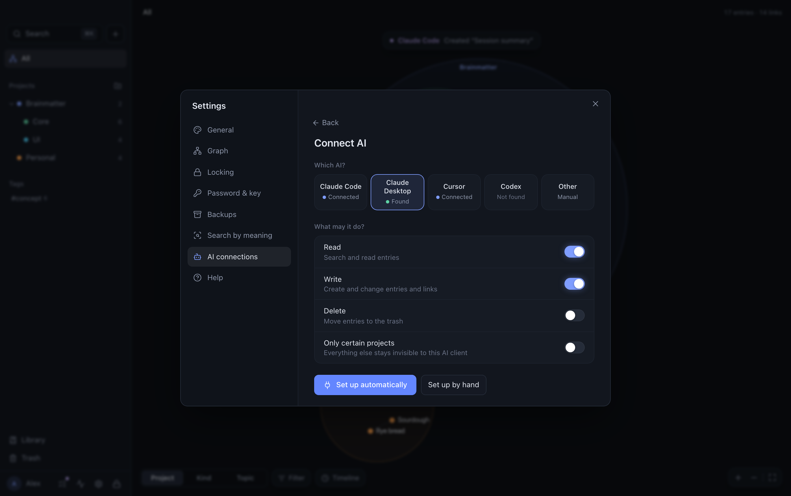
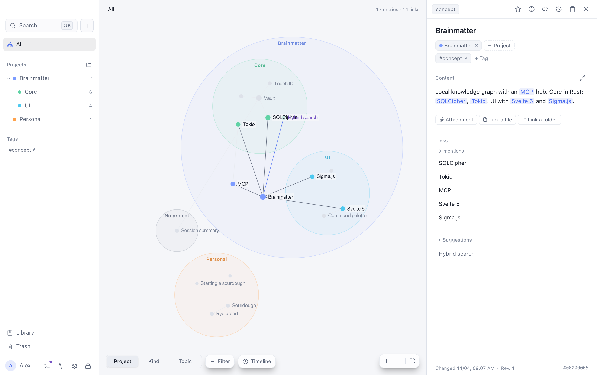

<p align="center">
  
</p>

<h1 align="center">Brainmatter</h1>

<p align="center">
  A local, encrypted knowledge graph for your Mac, and a shared memory for your AI tools.
</p>

<p align="center">
  <a href="https://github.com/Kiritosky/brainmatter/actions/workflows/ci.yml"></a>
  <a href="https://github.com/Kiritosky/brainmatter/releases/latest"></a>
  
  <a href="LICENSE"></a>
</p>



Brainmatter keeps simple entries, connects them by topic, and groups them into nested projects. Everything is stored on your Mac in an encrypted vault. Claude, Cursor, Codex and other tools connect through [MCP](https://modelcontextprotocol.io), so what one model learns is there for the next, and you can see and undo everything they do.

**Why it exists:** AI tools forget everything between sessions, and most tools that fix this send your notes to someone's server. Here the memory is yours: local, encrypted, readable by you, and open source.

> The interface follows the language of macOS, English or German. Updates carry your vault along, and everything can be exported as plain Markdown at any time. Brainmatter has not had an external security audit.

## Features

**Write and find**
- Markdown entries linked with `[[wikilinks]]` or typed relations such as `depends_on` and `contradicts`
- Type `/` to pick a heading, list, table or any other format, without knowing the Markdown for it
- Full-text search in German and English, and optionally by meaning, with a local model that also flags likely duplicates and suggests links
- Quick capture from anywhere with ⌥⇧Space, into the project of your choice
- Projects nested to any depth, an entry can be in several of them, and wherever you assign one you can search for it

**See how it connects**
- A graph that stays smooth with 50,000 entries, [measured](#performance), coloured by project, kind or automatically detected theme
- Each project is its own circle, subprojects sit inside it, and lines run only where entries are really linked
- ⌥-drag from one entry to another to link them, double-click a circle to go inside, Esc to go back up
- Saved views, filters, a local graph around one entry, and a time slider that replays how your graph grew
- Yours to adjust: group backgrounds, entry size, line weight, labels, accent colour, motion

**AI access you stay in control of**
- Set up Claude Code, Claude Desktop, Cursor and Codex in one click
- Each client gets its own token, limited to read, write or delete, and optionally to certain projects
- Whatever an AI writes is attributed to it and marked as unreviewed until you have seen it
- Every change can be undone, one step at a time, and the graph shows live what an AI is doing
- Built to save tokens: a [test](crates/bm-mcp/tests/token_cost.rs) holds the size of tool definitions and answers to a budget

**Encrypted, and yours to take along**
- The database, search index, embeddings, attachments and backups are all encrypted at rest
- Unlock with your password or Touch ID. While locked, an AI's request can ask you for Touch ID
- Locks automatically after a set time, on sleep, or with the screen
- Export everything as Markdown with front matter and wikilinks, whenever you like
- Import a folder of Markdown notes from Obsidian, Logseq or a Brainmatter export: folders become projects, links become connections, and the whole import can be undone in one click
- Verified daily backups, optionally copied to a second place such as an external drive, and a new Mac can start from them

**Project documentation**
- A handbook per project: pages in a tree, written right on the page, with a table of contents and search
- Mirror a repo's `docs` folder or `README.md` read-only. It follows the files live as you save them
- AI clients see the table of contents and read just the section they need

**Also included:** English and German, following macOS, a tour on first start and a help page in the settings, a library of templates and prompts with `{{placeholders}}` and a guided way to create them, links to files on your Mac, encrypted attachments with previews, a trash, light and dark themes, signed automatic updates.

<table>
  <tr>
    <td></td>
    <td></td>
  </tr>
  <tr>
    <td></td>
    <td></td>
  </tr>
  <tr>
    <td></td>
    <td></td>
  </tr>
</table>

## Install

Requires macOS 13 or newer on Apple Silicon.

The easiest way is Homebrew:

```sh
brew install --cask kiritosky/tap/brainmatter
```

If you installed it from the DMG before, add `--adopt` so Homebrew takes over the existing app.

Or download the DMG from the [latest release](https://github.com/Kiritosky/brainmatter/releases/latest) and drag Brainmatter to Applications.

Either way, macOS will refuse to open it the first time, because the app is not notarized. Go to **System Settings → Privacy & Security** and choose **Open Anyway**.

Later versions install themselves from inside the app. After each update it asks for your password once, then Touch ID works again.

Write down the recovery key the app shows you when you create your vault. **Without your password or that key, your data cannot be recovered**, by anyone.

## Connect your AI tools

Open **Settings → AI connections**, choose a tool and confirm. Brainmatter writes the configuration for you and never shows the token.

For anything else, create a token there and point the client at the local server:

```
http://127.0.0.1:47474/mcp
Authorization: Bearer <token>
```

Clients that only speak stdio can use the bridge inside the app bundle, `Brainmatter.app/Contents/MacOS/brainmatter-mcp`, with the token in `BRAINMATTER_TOKEN`.

| Tools | For |
|---|---|
| `search`, `get`, `explore`, `find_path`, `similar` | Finding and reading |
| `capture`, `update`, `link`, `unlink`, `merge`, `attach` | Writing |
| `list_projects`, `project_overview`, `create_project`, `update_project`, `delete_project`, `add_to_project`, `remove_from_project` | Projects |
| `read_attachment`, `unreviewed`, `unlinked`, `recent_changes` | Reviewing |
| `link_file`, `read_linked_file` | Files on your Mac |
| `list_docs`, `read_doc`, `write_doc` | Project documentation |
| `delete`, `trash`, `restore`, `revert` | Removing and undoing |
| `list_templates`, `get_template`, `save_template` | Reusable templates and prompts |

Connected models also get commands you can call by name, in Claude Code as `/mcp__brainmatter__setup-project`:

| Command | What the model does |
|---|---|
| `setup-project` | Builds a project's structure, docs and entries from the code and the conversation |
| `update-docs` | Compares a project's docs with its actual state and corrects them |
| `capture-session` | Saves what this session established, for later sessions and other models |
| `recall` | Answers a question from what Brainmatter knows |
| `tidy-project` | Merges duplicates, links loose entries and sorts them into subprojects |

Models are also told to save decisions, findings and your corrections without being asked, so what one model learns is there for the next.

Templates you have reviewed also appear as MCP prompts, so in Claude Code a template called "Code Review" becomes `/mcp__brainmatter__code-review`. A reviewed template named like a command replaces it, which is how you adapt one. Whatever an AI writes or changes in a template stays out of that list until you have looked at it, and connected clients are told when the list changes.

Projects and documentation pages are also available as MCP resources (`brainmatter://projects`, `brainmatter://project/{id}`, `brainmatter://doc/{id}`), within the same limits as the tools. Listing them never asks for Touch ID.

Entries can link to files and folders on your Mac; the link follows a file when it moves, and only the reference is stored. AI clients can read only linked text files, and a link an AI creates itself stays unreadable until you approve it.

Only you can mark entries as reviewed, erase them for good, manage backups or change settings.

## Security

| | |
|---|---|
| Database | SQLCipher (AES-256), including the search index and embeddings |
| Attachments | XChaCha20-Poly1305 with a key of their own; file names are keyed hashes |
| Key derivation | Argon2id (128 MiB, 3 passes) |
| Key hierarchy | A random data key, wrapped separately for password, recovery key and Touch ID |
| AI access | Local only (`127.0.0.1`), hashed bearer tokens, browser origins rejected |
| Network | Only update checks, which you can turn off, and the optional model download. Your entries never leave the Mac |

What this does not protect against: malware running as your user while the vault is unlocked, and a forgotten password together with a lost recovery key. Backups sit next to the vault unless you choose a second place for copies, so without one they do not help when the Mac is lost. A Markdown export is not encrypted, and the app says so before writing one.

Entries are treated as untrusted when shown: Markdown is sanitized, and AI clients are told that content is data, not instructions.

No external audit has been done. [SECURITY.md](SECURITY.md) has the design in full, what it does not protect against, and how to report a vulnerability privately.

## Performance

Measured on one Mac with an M2 Max, in the real app, against an invented vault of 50,000 entries and 147,677 links, on a display of 1920×966 at 1x and on a Retina display. Some early targets were missed, and the table says which.

| | Target | Measured | |
|---|---|---|---|
| Zooming, panning, hovering in the full graph | 60 fps | 59–60 fps, 95% of frames within 18–19 ms, on a Retina display as well | Met |
| Search by words, p95 | | 7.5 ms, with filters 7.8 ms, worst case 37 ms | |
| Search by meaning, p95 | 25 ms | 55 ms, the word search within it; the query vector (10 ms) is made meanwhile | Missed |
| MCP call, p95 | 15 ms | 0.5 ms for the transport, plus the work itself; not repeated at 50,000 | |
| Launch to lock screen | 300 ms | 0.65–0.75 s in a release build, of which about 0.55 s for the window and its web view to start | Missed |
| Unlock to first drawn graph | 1.5 s | 1.36–1.45 s; the links follow at about 2 s | Met |
| A change, such as one by an AI, on screen | | 0.25–0.3 s for an edit or a new entry, 1 s for a deletion | |
| Time slider, per step | | 250 ms, p95 310 ms | |
| Memory, as Activity Monitor counts it | 200 MB idle | With 3,000 entries: 190 MB for the app, 230–370 MB for its web view. With 50,000: 125–220 MB and 1.0–1.9 GB | Met for the app |
| Indexing for search by meaning | 5–20 ms per entry | 18 ms per entry, 15 minutes for 50,000, in the background | Met |

The first layout of 50,000 entries takes about 7 seconds. Opened again, a view shows its saved places at once.

Search by meaning was measured with a benchmark, not in the window. Its test words are prefixes shared by many entries, which makes it a hard case for the word search, which FTS5 has to rank across thousands of matches.

**Still slow at 50,000:** resizing the window goes through every entry and link, about 500 ms. Memory while indexing has not been measured as Activity Monitor counts it.

To repeat the measurements, see `app/scripts/perf-app.sh`, and `bm-core`'s `bench_engine` and `bm-embed`'s `bench_search` examples.

## Build from source

You need [Rust](https://rustup.rs) (the version in `rust-toolchain.toml` installs itself) and [Bun](https://bun.sh).

```sh
git clone https://github.com/Kiritosky/brainmatter
cd brainmatter/app
bun install
bun run tauri dev
```

Development builds use a separate vault and port, so they never touch your real data.

To try the interface without the native app, `bun run dev` runs it in a browser against an in-memory mock (password `demo1234`).

| | |
|---|---|
| `cargo test --workspace` | All tests |
| `bun run check` (in `app/`) | Typecheck the frontend |
| `bun scripts/screens.ts` (in `app/`) | Click through the interface against the mock, in German and English, and save screenshots |
| `bun scripts/readme-media.ts` (in `app/`) | Make the screenshots and the demo GIF in this README |
| `app/scripts/perf-app.sh` | Measure the real app against an invented vault from `seed_vault` |
| `cargo run --release -p bm-embed --example bench_search` | Measure search by meaning on such a vault, without a window |
| `scripts/build-release.sh` | A signed `.app` and DMG, using an identity from `scripts/create-signing-cert.sh` |

Pushing a tag such as `v1.2.0` runs the [release workflow](.github/workflows/release.yml).

## Architecture

```
crates/bm-core    Encrypted storage, graph, search, history, attachments, backups
crates/bm-embed   The local embedding model (candle on Metal)
crates/bm-mcp     The MCP server: tools, tokens, scopes
crates/bm-cli     brainmatter-mcp, a stdio bridge to that server
crates/bm-macos   Touch ID, Keychain, file events, sleep and screen-lock events, system language
app/src-tauri     The desktop app (Tauri 2): lock session, setup of AI tools, updates
app/src           The interface (Svelte 5, Sigma.js, CodeMirror)
```

The core has no UI or network dependencies.

## Contributing

Bug reports, ideas and pull requests are welcome. [CONTRIBUTING.md](CONTRIBUTING.md) explains the setup and the conventions, and issues labelled [good first issue](https://github.com/Kiritosky/brainmatter/labels/good%20first%20issue) are a place to start. Most interface work needs only `bun run dev`, no Mac-specific setup.

## License

[MIT](LICENSE)
